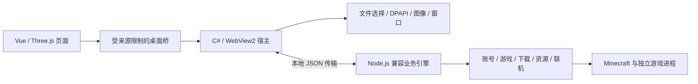

# 当前架构

ZeroDistance 0.3.0 的桌面窗口由 C# / .NET Framework 4.8 和系统 WebView2 提供，共用原来的 Vue 3、TypeScript、CSS 和 Three.js 界面。业务层目前仍使用随包提供的 Node.js 兼容引擎。没有内置 Electron 或 Chromium 副本，也没有完成全部业务后端的 C# 重写。

## 进程与协议

宿主启动自己的业务引擎，标准输出只传输 JSON 消息，诊断走标准错误和本地日志。IPC 名称和参数与共用类型对应，修改协议时必须更新宿主、兼容层和渲染端。后台任务需要取消、错误和退出路径。游戏以独立进程运行，启动器退出后不应被连带结束。

## 本地内容与权限

静态 UI 通过 WebView2 的虚拟主机目录映射读取。授权图片与插件使用独立通道，不把磁盘任意路径暴露给页面。新页面来源使用保留的 `.test` 域名。旧 `.local` 地址只在一次性 UI 偏好迁移期间使用，不能调用业务桥。

普通运行不启动 HTTP 服务或调试端口。仅 QA 模式允许本机调试，并限制配置目录在 `.qa` 内。第三方页面不能获得本机桥能力。

## 数据和启动

账号、设置、日志、同意记录与 WebView2 数据保存在兼容的数据目录。Windows 凭据通过当前用户 DPAPI 保护；软件不应把账号数据当成可共享的构建输入。临时目录在本软件数据目录内集中管理。

首次使用先显示声明门禁，之后才允许业务初始化。启动场景和界面准备并行；主窗口首次显示前为零透明度，首帧就绪后再显现，并移除预热分层样式。用户可关闭启动动画，系统减少动态效果也会影响表现。

## 外部服务与边界

Microsoft、Minecraft、Modrinth、加载器、联机服务和按需下载的网络工具由各自服务提供。离线身份不等于有效游戏授权。本机转发成功不能代替公网双机联机验证。工具下载需固定来源、校验内容，失败要能诊断和取消。

许可证范围、运行组件和对应源码见 [第三方声明](../THIRD_PARTY_NOTICES.md) 与 [对应源码](CORRESPONDING_SOURCE.md)。
